# jobagent

My job-search agent. It does the repetitive part of applying: it finds roles at 20+ companies,
scores each one against my CV, writes a tailored one-page CV per role, and waits for my OK on
Telegram before anything goes out. Runs 24/7 in Docker.

A match arrives looking like this (fictional job):

```text
Acme Systems — Junior C++ Engineer
Match: 82% · variant: systems
Strong fit: C++ on Linux, multithreading and sockets all match the role. Gap: no CUDA.
Prep: review CUDA basics before an interview
Job number: JR0012345
Apply link
               [ Approve ✓ ]   [ Skip ✗ ]
+ CV PDF attached, summary tailored to this role
```
<!-- Screenshot: save a redacted card as docs/card.png and replace the block above with
     . The leak guard can't read images, so redact by hand. -->

## How it works

```mermaid
flowchart LR
    A["Career APIs<br/>+ LinkedIn alerts"] --> B["Filter + dedupe<br/>location, seniority"]
    B --> C["Score with Claude<br/>pick a CV variant"]
    C -->|above threshold| D["Tailor summary<br/>render 1-page PDF"]
    D --> E["Telegram card<br/>Approve / Skip"]
    E -->|Approve| F["Email the recruiter,<br/>or I apply on the portal"]
    F --> G["Google Sheet row<br/>+ interview prep PDF"]
    G --> H["Inbox scan proposes<br/>status updates"]
```



- **Sources:** Workday (Nvidia, Intel, KLA, Palo Alto, Applied Materials, Marvell, Unity), Greenhouse
  (8 Israeli tech companies), Eightfold (Microsoft, Qualcomm), SmartRecruiters, Comeet, Amazon, Apple,
  and Jobify. LinkedIn jobs come from its alert emails: no login, no auto-apply.
- **Filtering** is free and runs first: location (Israel + remote), seniority in English and Hebrew,
  student-only roles, foreign clearances. Only what survives reaches the model.
- **Applying:** if the posting has a recruiter address, Approve sends the CV with a short cover note.
  Otherwise I get the CV and the link, apply myself, and tap Submitted.
- **Tracking:** each application becomes a row in my existing Google Sheet. When a company replies, the
  agent guesses the new stage and asks before changing the cell. Every update lands on Telegram
  and in one email thread per job.

## Design choices

- **The CV can't lie.** `cv/master.yaml` holds every fact once. Per role, the model may rewrite only
  the title and summary, it sees only an allow-listed facts text, and its output is validated
  (length, dashes, no new skills or claims). If it fails, the base summary goes out instead.
- **ATS-safe rendering:** one page, single column, no tables or images, non-breaking hyphens.
  A test renders every variant and fails on two pages.
- **Nothing is sent without Approve.** No duplicate applications, at most 2 per company per 30 days,
  and at most 10 cards a day. Unanswered cards get a short joke reply as a reminder, at most 3 times.
- **Every job is scored once.** Cross-source dedupe means a role seen again, or on a second site,
  never reaches the model twice.

## Numbers

- **~$0.0007** to score a job with Claude Haiku, **~$0.003** for an interview prep sheet.
- **600+ tests.** Sources are tested on saved responses, never live sites.

**Stack:** Python 3.12, Anthropic SDK, python-telegram-bot, Google Sheets API, Gmail IMAP/SMTP,
SQLite, APScheduler, python-docx + LibreOffice, Docker.

## Running it

```bash
python3 -m venv .venv && .venv/bin/pip install -r requirements.txt
cp .env.example .env                       # keys and ids
cp cv/master.example.yaml cv/master.yaml   # replace the fictional facts with yours
git config core.hooksPath .githooks        # leak guard, once per clone
.venv/bin/python -m pytest
docker compose up --build -d
```

Real data (`.env`, `secrets/`, `cv/master.yaml`, `data/`) is gitignored. `scripts/leakguard.py` runs
before every commit and push, and blocks anything that matches a key format or a value from the local `.env`.
